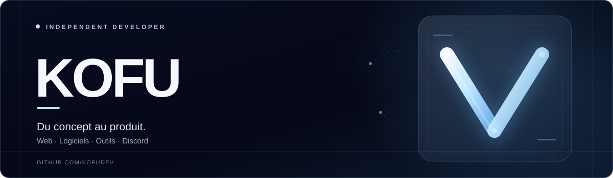

 

**Développeur web et créateur d'outils**  
Je conçois, développe et fais évoluer des produits utiles, du premier prototype à leur mise en ligne.

  &nbsp;
  &nbsp;
  

## À propos

J'aime comprendre ce qui se passe sous le capot et construire des outils qui répondent à de vrais besoins. Je travaille sur des applications web, des logiciels Windows, des bots Discord et les systèmes qui les font fonctionner.

Je développe également **[Varelia](https://varelia.fr)**, un studio de développement autour duquel je rassemble mes projets, mes applications et mes services.

## Projets sélectionnés

| Projet | Ce que je construis |
| :--- | :--- |
| **[Varelia Apps](https://app.varelia.fr)** | Un catalogue pour découvrir des applications développées par Varelia et d'autres créateurs. |
| **[TRACE](https://trace.varelia.fr)** | Une application Windows de suivi du temps passé sur son PC, avec une approche locale des données. |
| **[Bot Varelia](https://bots.varelia.fr)** | Un bot Discord personnalisable depuis une interface web. |
| **Varelia Security** | Un bot Discord de sécurité et de modération, accompagné d'un panel d'administration. |
| **[Varelia Status](https://status.varelia.fr)** | Une page dédiée à la disponibilité et au suivi des services Varelia. |

**Autres réalisations**  
`PostApo` — plugin pour Nova-Life: Amboise · `Advanced Compressor` — utilitaire Windows de compression · `Orizon Esport` — site d'équipe esport.

## Technologies

**Langages & web**

  &nbsp;&nbsp;
  &nbsp;&nbsp;
  &nbsp;&nbsp;
  &nbsp;&nbsp;
  &nbsp;&nbsp;
  

**Données, systèmes & outils**

  &nbsp;&nbsp;
  &nbsp;&nbsp;
  &nbsp;&nbsp;
  &nbsp;&nbsp;
  &nbsp;&nbsp;
  

## Écosystème Varelia

Je développe autant les interfaces que les outils et services qui les accompagnent : applications, automatisations, administration et infrastructure. Mon objectif : garder des projets **clairs à utiliser, simples à maintenir et capables d'évoluer**.

**[varelia.fr](https://varelia.fr)** · **[Applications](https://app.varelia.fr)** · **[Valcademy](https://valcademy.varelia.fr)** · **[Statut des services](https://status.varelia.fr)**

---

  Conçu et maintenu par Kofu · <a href="https://varelia.fr">Varelia</a>

